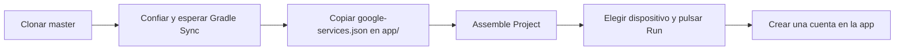
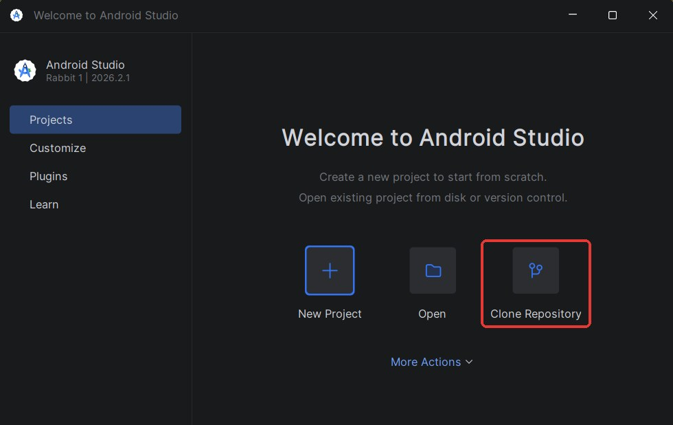
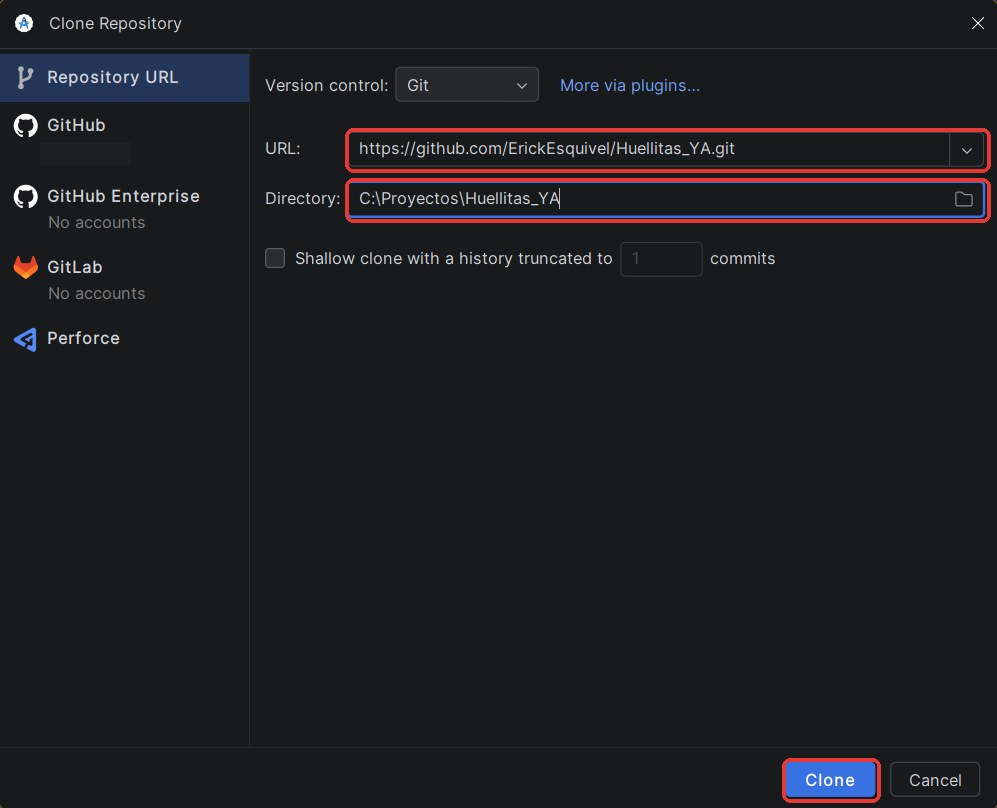
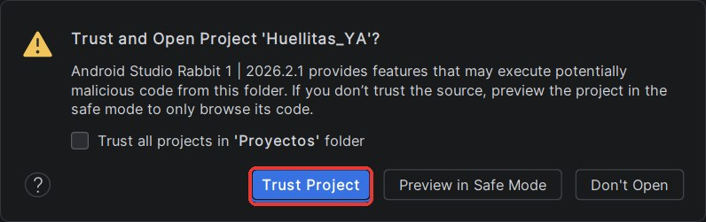
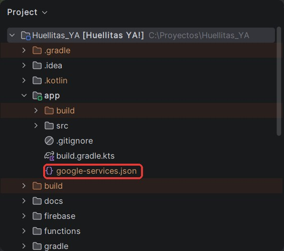
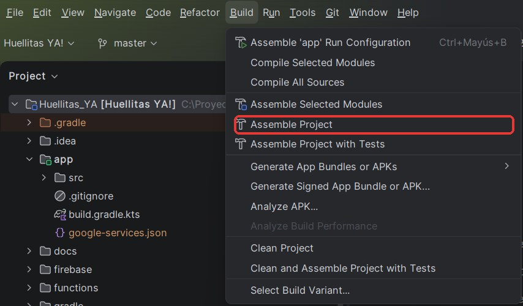
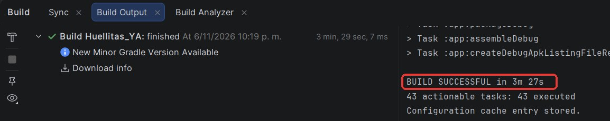
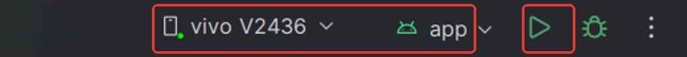
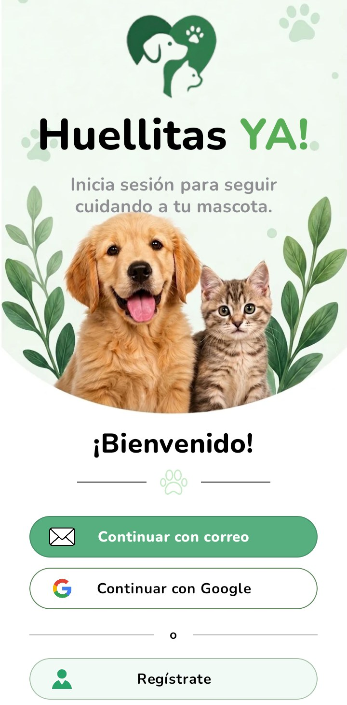

# Huellitas YA!

App Android para organizar las vacunas, el historial médico y los eventos de tus mascotas.

- **Cuentas:** registro con correo o Google, recuperación de contraseña con código, perfil.
- **Mascotas:** registrar, editar y eliminar, con foto.
- **Registros médicos:** subir PDF o imágenes, verlos y descargarlos.
- **Calendario:** recordatorios con aviso en el teléfono.

## Integrantes

- Julian Camilo Gonzalez Morales
- Mateo Sarmiento Cortes
- Erick Santiago Esquivel Cruz

## Versión funcional

La última versión funcional está en la rama **`master`** de este repositorio.

## Capturas

| Bienvenido | Iniciar sesión | Inicio |
|---|---|---|
|  |  |  |

| Perfil de la mascota | Registros médicos | Calendario |
|---|---|---|
|  |  |  |

## Cómo compilar e instalar la app

Esta guía parte de un equipo que nunca ha abierto el proyecto y lleva la app desde GitHub hasta un teléfono con Android Studio. Se completa en unos 30 minutos; la primera sincronización y la primera compilación son las que más tardan, porque descargan las dependencias.

Las capturas son de Android Studio 2026.2.1 en inglés, sobre un clon limpio de `master`.



### 1. Instalar lo necesario

| Herramienta | Versión | Notas |
|---|---|---|
| [Android Studio](https://developer.android.com/studio) | 2026.1.4 o superior | Trae el Android SDK y Java. |
| [Git](https://git-scm.com/downloads) | Cualquiera reciente | Android Studio lo usa para clonar. |
| Android SDK Platform | 37 | Android Studio ofrece instalarlo al abrir el proyecto (paso 3). |
| Teléfono o emulador | Android 7.0 (API 24) o superior | Con internet. Ver el paso 6. |

Pide también al equipo el archivo `google-services.json`; se usa en el paso 4.

No hace falta instalar Gradle: el proyecto trae Gradle Wrapper 9.6.0, que además descarga por su cuenta el JDK 25 con el que compila. Solo para compilar **desde una terminal externa** hace falta un Java (17 o superior) para arrancar Gradle; ver [Compilar desde una terminal](#compilar-desde-una-terminal).

### 2. Clonar el proyecto

1. Abre Android Studio y, en la pantalla de bienvenida, elige **Clone Repository**. Si se abre otro proyecto, usa **File → New → Project from Version Control**.

   

2. En **URL** escribe `https://github.com/ErickEsquivel/Huellitas_YA.git`.
3. En **Directory** elige la carpeta de destino, de preferencia una ruta corta como `C:\Proyectos\Huellitas_YA`.
4. Pulsa **Clone**. El proyecto queda en la rama `master`.

   

Si prefieres la terminal, clona con `git clone https://github.com/ErickEsquivel/Huellitas_YA.git` y abre la carpeta `Huellitas_YA` (la raíz, no `app/`) con **Open**.

### 3. Confiar en el proyecto y esperar Gradle Sync

1. Cuando Android Studio pregunte, elige **Trust Project**.

   

2. Si aparece **Sign in to Android Studio**, elige **Skip for now**. No hace falta una cuenta.
3. Espera a que termine **Gradle Sync**. El avance se ve en la barra inferior; la primera vez tarda unos 4 minutos.
4. Si aparece un aviso de que falta el SDK 37, haz clic en **Install** o instálalo en **Settings → Languages & Frameworks → Android SDK → SDK Platforms → Android API 37**, y sincroniza otra vez con **File → Sync Project with Gradle Files**.

Android Studio crea solo el archivo `local.properties`, con la ruta del SDK.

### 4. Agregar `google-services.json`

Este archivo conecta la app con Firebase. **Gradle Sync termina sin él, pero sin él el proyecto no compila.** Tiene las credenciales del proyecto, por eso no está en el repositorio y el equipo lo entrega por un canal privado.

1. Cópialo con el Explorador de archivos en la carpeta `app/`, no en la raíz del proyecto. Debe llamarse exactamente `google-services.json`.
2. En Android Studio, cambia la vista del panel izquierdo de **Android** a **Project**, porque la vista Android no muestra este archivo.
3. Si no aparece dentro de `app`, usa **File → Reload All from Disk**.

   

No lo subas al repositorio. Ya está en `.gitignore`, así que `git status` no debe mostrarlo.

### 5. Compilar

1. Abre el menú **Build → Assemble Project**.

   

2. Espera a que termine; la primera vez tarda unos 4 minutos. Para ver el resultado, abre el panel **Build** (ícono del martillo, abajo a la izquierda). Debe decir `BUILD SUCCESSFUL`.

   

El APK queda en `app/build/outputs/apk/debug/app-debug.apk`.

### 6. Ejecutar

Prepara un dispositivo. Elige una opción:

- **Teléfono físico:**
  1. Activa las **Opciones de desarrollador** (toca 7 veces **Número de compilación** en Ajustes → Acerca del teléfono).
  2. Activa **Depuración USB**.
  3. Conecta el teléfono y acepta el permiso que aparece.
- **Emulador:** en **Device Manager → Add a new device**, elige un equipo con el ícono de **Google Play** y una imagen de Android reciente.

Después selecciona el dispositivo en la barra superior de Android Studio, con la configuración `app`, y pulsa **Run ▶**. Android Studio instala la app en el dispositivo y la abre.



La app abre en la pantalla **Bienvenido**:



### 7. Comprobar que funciona

1. Toca **Regístrate** y crea una cuenta con tu correo.
2. Registra una mascota con su foto: la app te lleva a **Home** y la mascota aparece ahí.
3. En **Calendario**, crea un recordatorio. Acepta el permiso de notificaciones para recibir el aviso.

No hay que desplegar nada: la base de datos, las reglas de seguridad y las Cloud Functions ya están publicadas en el proyecto de Firebase `huellitasya-3fd78`.

### 8. Inicio de sesión con Google (opcional)

El inicio con correo y contraseña funciona sin más pasos. **"Continuar con Google" falla en un equipo nuevo** hasta registrar su huella digital, porque cada computador firma la app con su propia clave de depuración.

1. Ejecuta en la raíz del proyecto:

   ```bash
   # Windows
   gradlew.bat signingReport

   # macOS o Linux
   ./gradlew signingReport
   ```

2. En la salida, busca `Variant: debug` y copia los valores `SHA1` y `SHA-256`.
3. Envíalos al equipo, que los registra en la consola de Firebase.
4. Espera unos minutos y vuelve a probar. Si sigue fallando, pide al equipo un `google-services.json` actualizado y repite desde el paso 4.

El dispositivo necesita Google Play y una cuenta de Google iniciada.

### Compilar desde una terminal

Es opcional y reemplaza el paso 5. En la raíz del proyecto:

```bash
# Windows
gradlew.bat assembleDebug

# macOS o Linux
./gradlew assembleDebug
```

La terminal de Android Studio (**View → Tool Windows → Terminal**) ya viene lista. En una terminal externa, si `java -version` no responde, usa el Java de Android Studio:

```bash
# Windows, en PowerShell
$env:JAVA_HOME = "C:\Program Files\Android\Android Studio\jbr"

# macOS
export JAVA_HOME="/Applications/Android Studio.app/Contents/jbr/Contents/Home"
```

Si no abriste el proyecto antes en Android Studio, primero crea `local.properties` en la raíz con la ruta de tu SDK:

```properties
# Windows (las barras se escriben dobles)
sdk.dir=C\:\\Users\\TU_USUARIO\\AppData\\Local\\Android\\Sdk
# macOS
# sdk.dir=/Users/TU_USUARIO/Library/Android/sdk
# Linux
# sdk.dir=/home/TU_USUARIO/Android/Sdk
```

Al terminar debe decir `BUILD SUCCESSFUL`.

### Problemas comunes

| Qué aparece | Causa | Solución |
|---|---|---|
| `File google-services.json is missing` | Falta el archivo o está en la raíz | Cópialo en `app/` (paso 4). |
| `No matching client found for package name` | El archivo es de otra app de Firebase | Pide al equipo el archivo correcto: el paquete debe ser `com.example.huellitasya`. |
| `JAVA_HOME is not set` o `java` no se reconoce | La terminal no encuentra Java | Usa la terminal de Android Studio o define `JAVA_HOME` ([Compilar desde una terminal](#compilar-desde-una-terminal)). |
| `SDK location not found` | Falta la ruta del SDK | Abre el proyecto en Android Studio o crea `local.properties` ([Compilar desde una terminal](#compilar-desde-una-terminal)). |
| `Failed to find target with hash string 'android-37'` | Falta el SDK 37 | Instálalo (paso 3). |
| Falla la descarga de dependencias o del JDK | Sin internet o con un proxy | Revisa la conexión y repite con **Sync Project**. |
| `Unable to delete directory` (Windows) | Android Studio u otro programa tiene bloqueada `app/build` | Cierra el programa y compila otra vez. |
| `INSTALL_FAILED_UPDATE_INCOMPATIBLE` | El dispositivo ya tiene la app firmada con otra clave | Desinstala la app del dispositivo y pulsa **Run ▶** otra vez. |
| "Continuar con Google" muestra un error | Falta registrar la huella del equipo | Sigue el paso 8. |
| "Sin conexión" en la app | El dispositivo no tiene internet | Conéctalo a una red con internet. La app la necesita para entrar y guardar. |

## Tests

```bash
# App (en Windows, gradlew.bat)
./gradlew testDebugUnitTest

# Cloud Functions (requiere Node 22)
npm --prefix functions install
npm --prefix functions test
```

## Datos del proyecto

| | |
|---|---|
| Paquete | `com.example.huellitasya` |
| minSdk / compileSdk / targetSdk | 24 / 37 / 37 |
| Android Gradle Plugin | 9.4.1 |
| Gradle | 9.6.0 (Wrapper) |
| Kotlin | 2.2.10 |
| Compatibilidad del código | Java 11 |
| Firebase | `huellitasya-3fd78`, región `southamerica-east1` |

## Stack

- **UI:** Jetpack Compose + Material 3, tipografía Nunito.
- **Arquitectura:** MVVM, Hilt y Navigation Compose con destinos tipados, en un solo módulo `:app` organizado por paquetes.
- **Backend:** Firebase Authentication, Cloud Firestore, Cloud Storage y Cloud Functions (TypeScript).
- **Avisos:** WorkManager.

## Estructura (`app/src/main/kotlin/com/example/huellitasya/`)

| Paquete | Contenido |
|---------|-----------|
| raíz y `navigation/` | Punto de entrada, sesión y navegación raíz |
| `core/model`, `core/common`, `core/domain` | Modelos, resultados tipados, repositorios (interfaces), casos de uso y validaciones (Kotlin puro) |
| `core/data` | Implementaciones con Firebase y módulos Hilt |
| `core/designsystem` | Tema, tokens y componentes Compose |
| `core/ui` | Utilidades de UI compartidas |
| `feature/*` | auth, home, pets, records, calendar, profile, settings |

Fuera de `app/` están `functions/` (backend), `firebase/` (reglas de seguridad) y `specs/` (especificaciones).

## Documentación

- [Guía técnica](docs/README.md): carpetas, capas y flujos línea por línea, de la pantalla a Firebase.
- [Especificaciones](specs/README.md): el comportamiento de cada módulo. Son la fuente de verdad.
- [Configuración de Firebase](specs/001-firebase-setup.md): para montar un proyecto propio desde cero.
- [Diseño en Figma](https://www.figma.com/design/02Bq5fbLLxTbaAD5hZ1sxS/Huellitas-YA-).
