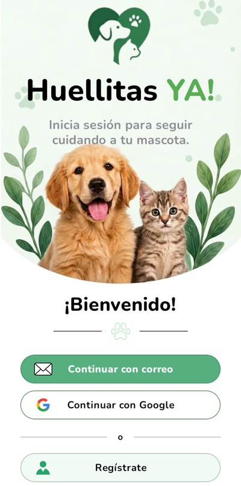
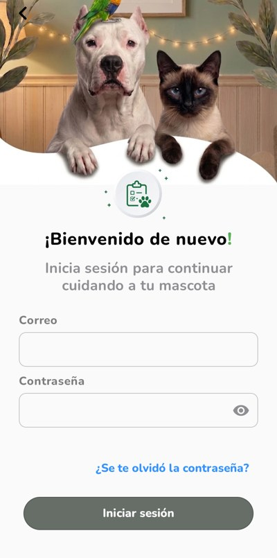
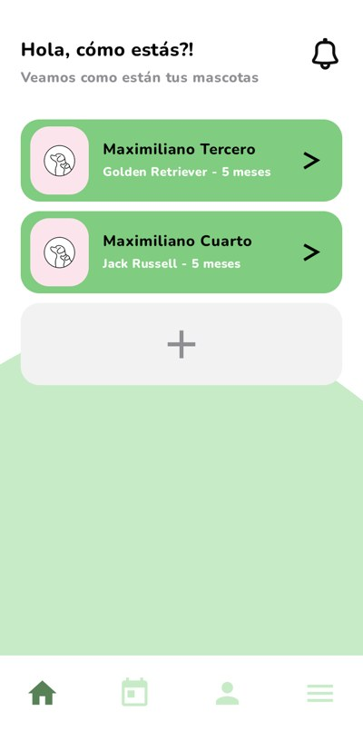
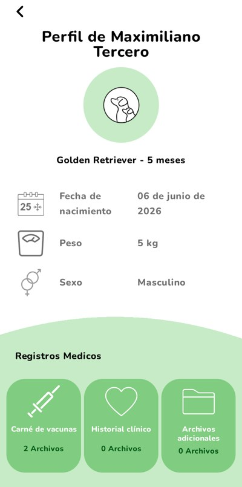
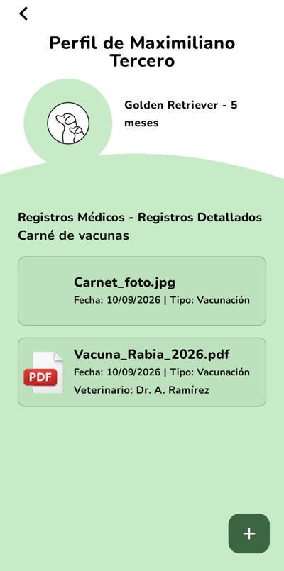
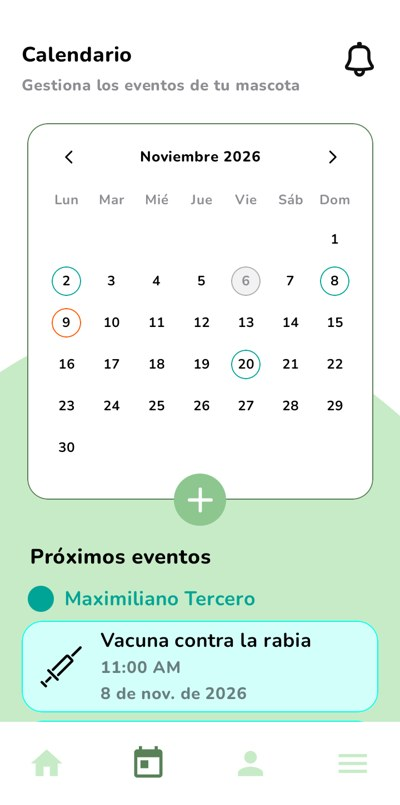
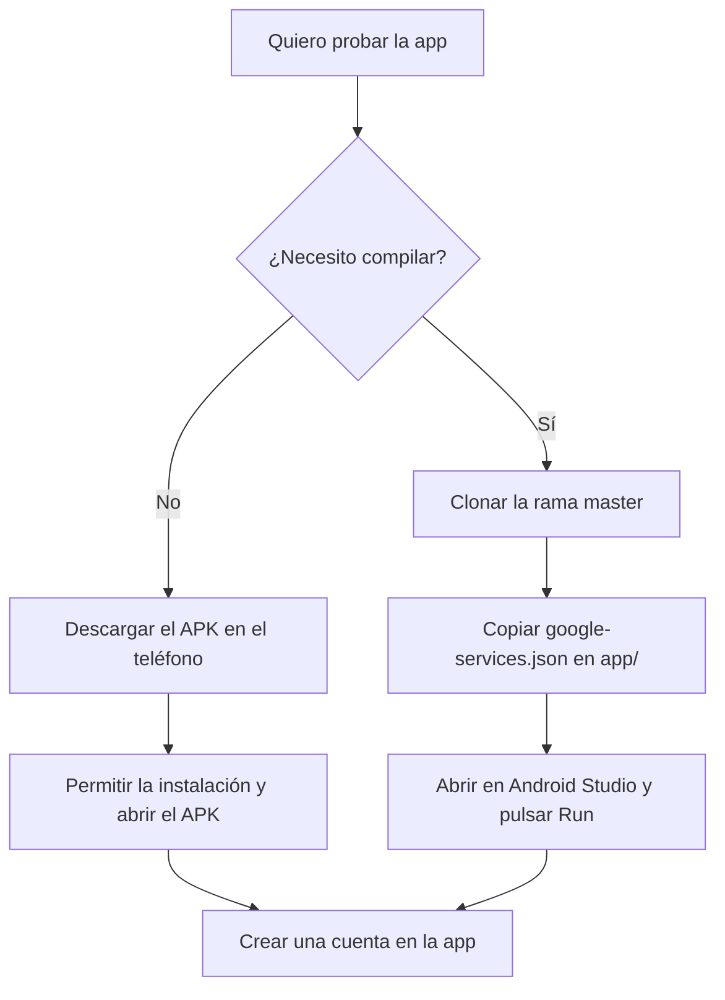

# Huellitas YA!

App Android para organizar las vacunas, el historial médico y los eventos de tus mascotas.

- **Cuentas:** registro con correo o Google, recuperación de contraseña con código, perfil.
- **Mascotas:** registrar, editar y eliminar, con foto.
- **Registros médicos:** subir PDF o imágenes, verlos y descargarlos.
- **Calendario:** recordatorios con aviso en el teléfono.

## Integrantes

- Julian Camilo Gonzalez Morales
- Mateo Sarmiento Cortes
- Erick Santiago Esquivel Cruz

## Versión funcional

La última versión funcional está en la rama **`master`** de este repositorio.

## Capturas

| Bienvenido | Iniciar sesión | Inicio |
|---|---|---|
|  |  |  |

| Perfil de la mascota | Registros médicos | Calendario |
|---|---|---|
|  |  |  |

## Cómo instalar la app

Hay dos caminos. El más rápido no requiere compilar.



### Opción rápida: instalar el APK

Necesitas un teléfono con Android 7.0 o superior y conexión a internet.

1. En el teléfono, abre este enlace: [descargar HuellitasYA-1.0.apk](https://github.com/ErickEsquivel/Huellitas_YA/releases/latest/download/HuellitasYA-1.0.apk).
2. Abre el archivo descargado. Si Android lo pide, permite instalar apps de esa fuente.
3. Si Google Play Protect muestra un aviso, elige instalar de todos modos. Aparece porque la app no viene de Play Store.
4. Abre **Huellitas YA!** y sigue la [comprobación del paso 7](#7-comprobar-que-funciona).

Con este APK también funciona "Continuar con Google", porque está firmado con la clave registrada en Firebase.

### Opción completa: compilar el proyecto

Sigue la guía de la siguiente sección.

## Compilar y ejecutar en otro equipo

Esta guía parte de un equipo que nunca ha abierto el proyecto. Se completa en unos 30 minutos; la primera compilación es la que más tarda, porque descarga las dependencias.

### 1. Instalar lo necesario

| Herramienta | Versión | Notas |
|---|---|---|
| [Android Studio](https://developer.android.com/studio) | 2026.1.4 o superior | Trae el Android SDK. |
| [Git](https://git-scm.com/downloads) | Cualquiera reciente | Para clonar el proyecto. |
| Android SDK Platform | 37 | Android Studio ofrece instalarlo al abrir el proyecto (paso 4). |
| Teléfono o emulador | Android 7.0 (API 24) o superior | Con internet. Ver el paso 6. |

No hace falta instalar Gradle: el proyecto trae Gradle Wrapper 9.6.0, que además descarga por su cuenta el JDK 25 con el que compila. Android Studio ya incluye Java, así que tampoco hay que instalarlo. Solo para compilar **desde una terminal externa** hace falta un Java (17 o superior) para arrancar Gradle; ver el paso 5.

### 2. Clonar el proyecto

```bash
git clone https://github.com/ErickEsquivel/Huellitas_YA.git
cd Huellitas_YA
git checkout master
```

### 3. Agregar `google-services.json`

Este archivo conecta la app con Firebase. **Sin él, el proyecto no compila.** Tiene las credenciales del proyecto, por eso no está en el repositorio y el equipo lo entrega por un canal privado.

1. Pide el archivo al equipo.
2. Cópialo en la carpeta `app/`, no en la raíz del proyecto. Debe llamarse exactamente `google-services.json`:

   ```text
   Huellitas_YA/
   ├── app/
   │   ├── google-services.json   ← aquí
   │   ├── build.gradle.kts
   │   └── src/
   ├── gradle/
   └── README.md
   ```

3. No lo subas al repositorio. Ya está en `.gitignore`, así que `git status` no debe mostrarlo.

### 4. Abrir el proyecto en Android Studio

1. Abre Android Studio y elige **Open**.
2. Selecciona la carpeta `Huellitas_YA` (la raíz, no `app/`).
3. Espera a que termine **Gradle Sync**. El avance se ve en la barra inferior.
4. Si aparece un aviso de que falta el SDK 37, haz clic en **Install** o instálalo en **Settings → Languages & Frameworks → Android SDK → SDK Platforms → Android API 37**, y sincroniza otra vez con **File → Sync Project with Gradle Files**.

Android Studio crea solo el archivo `local.properties`, con la ruta del SDK.

### 5. Compilar

**Desde Android Studio:** menú **Build → Assemble Project**.

**O desde una terminal,** en la raíz del proyecto:

```bash
# Windows
gradlew.bat assembleDebug

# macOS o Linux
./gradlew assembleDebug
```

La terminal de Android Studio (**View → Tool Windows → Terminal**) ya viene lista. En una terminal externa, si `java -version` no responde, usa el Java de Android Studio:

```bash
# Windows, en PowerShell
$env:JAVA_HOME = "C:\Program Files\Android\Android Studio\jbr"

# macOS
export JAVA_HOME="/Applications/Android Studio.app/Contents/jbr/Contents/Home"
```

Si no abriste el proyecto antes en Android Studio, primero crea `local.properties` en la raíz con la ruta de tu SDK:

```properties
# Windows (las barras se escriben dobles)
sdk.dir=C\:\\Users\\TU_USUARIO\\AppData\\Local\\Android\\Sdk
# macOS
# sdk.dir=/Users/TU_USUARIO/Library/Android/sdk
# Linux
# sdk.dir=/home/TU_USUARIO/Android/Sdk
```

Al terminar debe decir `BUILD SUCCESSFUL`. El APK queda en `app/build/outputs/apk/debug/app-debug.apk`.

### 6. Ejecutar

Elige una opción:

- **Teléfono físico:**
  1. Activa las **Opciones de desarrollador** (toca 7 veces **Número de compilación** en Ajustes → Acerca del teléfono).
  2. Activa **Depuración USB**.
  3. Conecta el teléfono y acepta el permiso que aparece.
- **Emulador:** en **Device Manager → Add a new device**, elige un equipo con el ícono de **Google Play** y una imagen de Android reciente.

Después selecciona el dispositivo en la barra superior de Android Studio y pulsa **Run ▶** (configuración `app`).

### 7. Comprobar que funciona

1. La app abre en la pantalla **Bienvenido**.
2. Toca **Regístrate** y crea una cuenta con tu correo.
3. Registra una mascota con su foto: la app te lleva a **Home** y la mascota aparece ahí.
4. En **Calendario**, crea un recordatorio. Acepta el permiso de notificaciones para recibir el aviso.

No hay que desplegar nada: la base de datos, las reglas de seguridad y las Cloud Functions ya están publicadas en el proyecto de Firebase `huellitasya-3fd78`.

### 8. Inicio de sesión con Google (opcional)

El inicio con correo y contraseña funciona sin más pasos. **"Continuar con Google" falla en un equipo nuevo** hasta registrar su huella digital, porque cada computador firma la app con su propia clave de depuración.

1. Ejecuta en la raíz del proyecto:

   ```bash
   # Windows
   gradlew.bat signingReport

   # macOS o Linux
   ./gradlew signingReport
   ```

2. En la salida, busca `Variant: debug` y copia los valores `SHA1` y `SHA-256`.
3. Envíalos al equipo, que los registra en la consola de Firebase.
4. Espera unos minutos y vuelve a probar. Si sigue fallando, pide al equipo un `google-services.json` actualizado y repite desde el paso 3.

El dispositivo necesita Google Play y una cuenta de Google iniciada.

### Problemas comunes

| Qué aparece | Causa | Solución |
|---|---|---|
| `File google-services.json is missing` | Falta el archivo o está en la raíz | Cópialo en `app/` (paso 3). |
| `No matching client found for package name` | El archivo es de otra app de Firebase | Pide al equipo el archivo correcto: el paquete debe ser `com.example.huellitasya`. |
| `JAVA_HOME is not set` o `java` no se reconoce | La terminal no encuentra Java | Usa la terminal de Android Studio o define `JAVA_HOME` (paso 5). |
| `SDK location not found` | Falta la ruta del SDK | Abre el proyecto en Android Studio o crea `local.properties` (paso 5). |
| `Failed to find target with hash string 'android-37'` | Falta el SDK 37 | Instálalo (paso 4). |
| Falla la descarga de dependencias o del JDK | Sin internet o con un proxy | Revisa la conexión y repite con **Sync Project**. |
| `Unable to delete directory` (Windows) | Android Studio u otro programa tiene bloqueada `app/build` | Cierra el programa y compila otra vez. |
| "Continuar con Google" muestra un error | Falta registrar la huella del equipo | Sigue el paso 8. |
| "Sin conexión" en la app | El dispositivo no tiene internet | Conéctalo a una red con internet. La app la necesita para entrar y guardar. |

## Tests

```bash
# App (en Windows, gradlew.bat)
./gradlew testDebugUnitTest

# Cloud Functions (requiere Node 22)
npm --prefix functions install
npm --prefix functions test
```

## Datos del proyecto

| | |
|---|---|
| Paquete | `com.example.huellitasya` |
| minSdk / compileSdk / targetSdk | 24 / 37 / 37 |
| Android Gradle Plugin | 9.4.1 |
| Gradle | 9.6.0 (Wrapper) |
| Kotlin | 2.2.10 |
| Compatibilidad del código | Java 11 |
| Firebase | `huellitasya-3fd78`, región `southamerica-east1` |

## Stack

- **UI:** Jetpack Compose + Material 3, tipografía Nunito.
- **Arquitectura:** MVVM, Hilt y Navigation Compose con destinos tipados, en un solo módulo `:app` organizado por paquetes.
- **Backend:** Firebase Authentication, Cloud Firestore, Cloud Storage y Cloud Functions (TypeScript).
- **Avisos:** WorkManager.

## Estructura (`app/src/main/kotlin/com/example/huellitasya/`)

| Paquete | Contenido |
|---------|-----------|
| raíz y `navigation/` | Punto de entrada, sesión y navegación raíz |
| `core/model`, `core/common`, `core/domain` | Modelos, resultados tipados, repositorios (interfaces), casos de uso y validaciones (Kotlin puro) |
| `core/data` | Implementaciones con Firebase y módulos Hilt |
| `core/designsystem` | Tema, tokens y componentes Compose |
| `core/ui` | Utilidades de UI compartidas |
| `feature/*` | auth, home, pets, records, calendar, profile, settings |

Fuera de `app/` están `functions/` (backend), `firebase/` (reglas de seguridad) y `specs/` (especificaciones).

## Documentación

- [Guía técnica](docs/README.md): carpetas, capas y flujos línea por línea, de la pantalla a Firebase.
- [Especificaciones](specs/README.md): el comportamiento de cada módulo. Son la fuente de verdad.
- [Configuración de Firebase](specs/001-firebase-setup.md): para montar un proyecto propio desde cero.
- [Diseño en Figma](https://www.figma.com/design/02Bq5fbLLxTbaAD5hZ1sxS/Huellitas-YA-).
